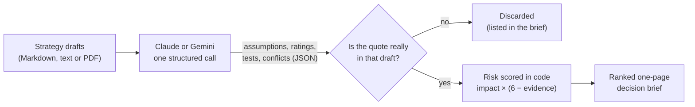

# Second Cut

**An AI agent that stress-tests a strategy before you bet on it.**

[](https://github.com/yengnongxiong/ai-agent-consultant/actions/workflows/tests.yml)


AI agents can now draft a business strategy in minutes. That draft is a useful first cut, and it
is also a stack of untested bets. Second Cut reads one or more drafts and does three things:

1. **Finds the bets.** It pulls out the beliefs the plan depends on, each backed by an exact quote.
2. **Ranks them by risk.** It shows which belief could sink the plan and how little evidence supports it.
3. **Designs the test.** For each belief it proposes the cheapest experiment that could prove it wrong, with clear "go" and "kill" results.

It also flags places where drafts contradict each other.

> The first draft tells you what to do. The second cut tells you what to prove first.

**Contents:** [See it in action](#see-it-in-action) · [How it works](#how-it-works) ·
[Design choices](#design-choices-and-their-trade-offs) · [Run it yourself](#run-it-yourself) ·
[Security, privacy and legal](#security-privacy-and-legal) · [Limitations and roadmap](#limitations-and-roadmap) ·
[Project layout](#project-layout) · [Product requirements (PRD)](PRD.md)

---

## See it in action

The [`examples/`](examples/) folder holds two first-cut drafts for **Corvane Industrial Supply**, an
invented regional distributor:

- [`growth-draft.md`](examples/growth-draft.md): an ambitious plan to launch a paid membership, AI reorder suggestions and 20 new sales hires.
- [`workforce-draft.md`](examples/workforce-draft.md): a readiness review of the same company's people, data and constraints.

Each draft sounds reasonable on its own. Second Cut reads them together and produces
**[the decision brief in `examples/brief.md`](examples/brief.md)**.

An excerpt from that brief:

> **Bottom line:** 7 of 7 load-bearing assumptions are high-risk (score 15+ of 25). Run their tests before committing budget.

| # | Risk | Assumption | Lens | Impact | Evidence |
|---|---|---|---|---|---|
| 1 | **25** | Shifting orders online will drive overall gross margin from 22% up to 26% within 18 months despite bulk discounts and delivery costs. | viability | 5/5 | 1/5 |
| 2 | **20** | Contractors will pay a $49 monthly membership fee to receive free next-day delivery and bulk pricing. | desirability | 5/5 | 2/5 |
| 3 | **20** | Contractors will accept unassisted digital ordering rather than relying on branch staff to check their orders. | desirability | 5/5 | 2/5 |

**Test for #2 (14 days):** Outreach by sales reps to 50 top-500 accounts offering an early binding
pre-order contract for the $49/month Pro subscription. **Go** if 30% or more sign; **kill** if fewer than 10% do.

**One of four conflicts caught:** the growth draft says *"Hire 20 inside-sales reps in Q1"*, while
the workforce draft says *"A hiring freeze holds through the end of next fiscal year."*

On this run the tool caught all four contradictions planted between the drafts (hiring, data quality,
IT capacity and customer readiness), and every quote in the brief passed verification against its
source. Every bet scored high-risk because the growth draft states most of them without evidence,
which is exactly the habit a second cut exists to catch. The brief was generated with
`gemini-3.8-flash` on Google's free tier, using 1,445 input and 1,944 output tokens.

## How it works



1. **Read.** You give it one or more strategy drafts as Markdown, plain text or PDF. PDFs are converted to text on your machine.
2. **Find the bets.** The model (Claude by default, or Gemini) names the 5 to 12 load-bearing assumptions. It rates each one for **impact** (1 to 5: how badly the plan fails if the belief is wrong) and **evidence** (1 to 5: how much the drafts actually support it), and designs a test for each.
3. **Check the receipts.** Plain code confirms that every assumption's quote appears word for word in the draft it cites. Anything that can't be traced is thrown out and listed, never silently kept.
4. **Rank.** Code computes **risk = impact × (6 − evidence)**, from 1 to 25, and sorts. High impact plus thin evidence floats to the top.
5. **Brief.** The result is a one-page Markdown brief that pastes cleanly into a doc, an email or a ticket.

Every assumption is tagged with one of four lenses, so a reader can see *what kind* of risk dominates:

| Lens | The question it asks |
|---|---|
| **Desirability** | Do customers actually want this? |
| **Viability** | Do the economics work? |
| **Feasibility** | Can we build or deliver it? |
| **Readiness** | Can our people, processes and data absorb the change? |

The first three are the classic product-strategy lens. **Readiness** is added because many strategies
that pass the first three still fail on execution: the organization can't take on the change.

## Design choices and their trade-offs

These are the product and system-design decisions that shape the tool, with what each one costs.

| Decision | What I chose | Why | What it gives up |
|---|---|---|---|
| **Who does the math** | The model judges; code computes. The model rates impact and evidence, and Python does the scoring and ranking. | The same ratings always produce the same ranking. The rule is one visible line anyone can debate. | Ratings of 1 to 5 are coarse, and a model's ratings can vary between runs. |
| **Receipts required** | Every finding must quote its source word for word, and code checks it. | An invented assumption can't slip into the brief, and a reviewer can audit any claim in seconds. | A real assumption the model paraphrases gets discarded. The brief lists every discard, so nothing disappears silently. |
| **One call, not a swarm of agents** | One structured request per run. | One cost, one point of failure, one place to audit. It's fast to run and easy to explain. | There's no separate critic pass. Add one only if evaluation shows assumptions being missed. |
| **Structured output** | The response must match a JSON schema and is validated before use. | There's no fragile text parsing, and it limits what a malicious instruction hidden in a draft could do. | Changing the output means changing the schema in code. |
| **Tests with kill criteria** | Every test states a go result *and* a kill result. | A test that can't fail can't change a decision. | The thresholds are model-suggested starting points; teams should set their own before running the test. |
| **PDFs become text locally** | PDF text is extracted on your machine before anything is sent. | The quote check needs exactly the text the model saw. Only text leaves your machine, never the file's images or metadata. | Charts, images and scanned pages are invisible to the analysis. |
| **Command line + Markdown** | No server, no database, no accounts. | Nothing to host, maintain or breach, and the output works anywhere text works. | No point-and-click interface; someone needs to run one command. |
| **Model** | Claude Opus 5.5 at high reasoning effort by default. | Spotting which beliefs are load-bearing is the hard, judgment-heavy part. It's worth paying for quality on a tool used once per decision. | Slower and more expensive per run than smaller models. |
| **Provider choice** | Claude or Gemini, picked with an explicit `--provider` flag, never guessed from which key is set. | Many companies approve exactly one AI vendor. An explicit choice means you always know which company receives your drafts. | Two integrations to maintain, and results vary by model. The prompt, quote checks and scoring are shared, so only the API call differs. |
| **Judge only what's written** | No web search; evidence is rated only from the drafts. | It shows how well the *draft* supports its own claims, and keeps runs fast, cheap and repeatable. | It can't tell you whether outside evidence exists, only that the draft didn't show it. |

## Run it yourself

You need [Python 3.11+](https://www.python.org/downloads/), [uv](https://docs.astral.sh/uv/getting-started/installation/)
and an [Anthropic API key](https://console.anthropic.com/), or a Gemini key (see below).

```bash
git clone https://github.com/yengnongxiong/ai-agent-consultant.git
cd ai-agent-consultant

# Paste your key at the prompt. It is read without echoing and stays out of your shell history.
read -rs ANTHROPIC_API_KEY && export ANTHROPIC_API_KEY

uv run secondcut.py examples/growth-draft.md examples/workforce-draft.md > brief.md
```

**Using Gemini instead?** Get a key from [Google AI Studio](https://aistudio.google.com/apikey), then:

```bash
read -rs GEMINI_API_KEY && export GEMINI_API_KEY
uv run --extra gemini secondcut.py --provider gemini examples/growth-draft.md examples/workforce-draft.md > brief.md
```

`uv` installs the exact dependency versions from `uv.lock` on first run. Progress and token usage
print to the terminal, and the brief goes to `brief.md`. Use your own drafts by passing their file paths instead; Markdown, text and PDF files all work.

To run the test suite (no API key, no network, under a second):

```bash
uv run pytest
```

## Security, privacy and legal

- **Your drafts go to exactly one place:** the AI provider you choose (Anthropic by default, or Google), over HTTPS. Second Cut has no server, database, logging, telemetry or analytics, and it saves nothing except the brief you redirect to a file. Each provider's terms govern how it handles inputs: see Anthropic's [commercial terms](https://www.anthropic.com/legal/commercial-terms) and Google's [Gemini API pricing page](https://ai.google.dev/gemini-api/docs/pricing). **Google's free tier may use inputs to improve its products, so never send confidential drafts on a free key.** Check your organization's policy first.
- **Your API key** is read from the environment by the provider's official SDK. It is never written to disk, logged or printed.
- **Drafts are treated as untrusted input.** They are clearly labeled as data, and the model is told never to follow instructions inside them. The model has no tools: it cannot browse, run code or touch files. Its only output is JSON checked against a schema, and its text is escaped before going into the brief, so a malicious draft can't plant links or HTML. PDFs are parsed locally by `pypdf`, a pure-Python library with no native code. Files over 20 MB are refused, and so are password-protected ones.
- **Cost is bounded.** Input is capped at 200,000 characters per run, and every run prints its token usage.
- **Small supply chain.** By default there are two runtime dependencies: the official `anthropic` SDK and `pypdf`, which has no dependencies of its own. Google's official SDK installs only if you opt into Gemini. Every version is locked by hash in `uv.lock`. CI runs with read-only permissions, uses actions pinned to exact commits, and fails if the lockfile drifts.
- **Legal.** MIT licensed. This is an independent project, not affiliated with or endorsed by any company. The example company and its figures are fictional. Output is AI-generated analysis, not professional, financial or legal advice.

## Limitations and roadmap

**Known limitations**

- It knows only what is in the drafts: no market data and no outside research (see *Judge only what's written* above).
- The ranking rule is fixed, but the ratings that feed it come from a model and can shift between runs.
- Quote matching compares characters only, ignoring case, spacing, line breaks, hyphens, curly quotes and bold text. A paraphrased quote is discarded, even when the idea behind it is real.
- Scanned PDFs (pictures of text) and slide decks aren't supported, and charts or images inside PDFs are ignored.

**Next, in priority order (not built yet)**

1. **Evaluation set:** drafts with known, planted assumptions, to measure how many the tool finds before any prompt change ships.
2. **Agent-to-agent use:** expose Second Cut as an [MCP](https://modelcontextprotocol.io/) tool so other AI agents can call it right after drafting a strategy.
3. **Assumption tracking:** save results as data, so a team can record test outcomes and re-rank as evidence arrives.

## Project layout

```text
secondcut.py   The whole agent in one readable file: prompt, output schema, quote checks, scoring, brief
tests/         Offline tests with a fake client: no API key, no network, no cost
examples/      Fictional input drafts and the brief they produce
PRD.md         Product requirements: problem, users, goals, success metrics, risks
```

The agent's instructions to the model are plain English: see `SYSTEM` near the top of
[`secondcut.py`](secondcut.py). Changing how the agent thinks means editing a paragraph, not code.

## License

[MIT](LICENSE) © 2026 Yengnong Xiong
