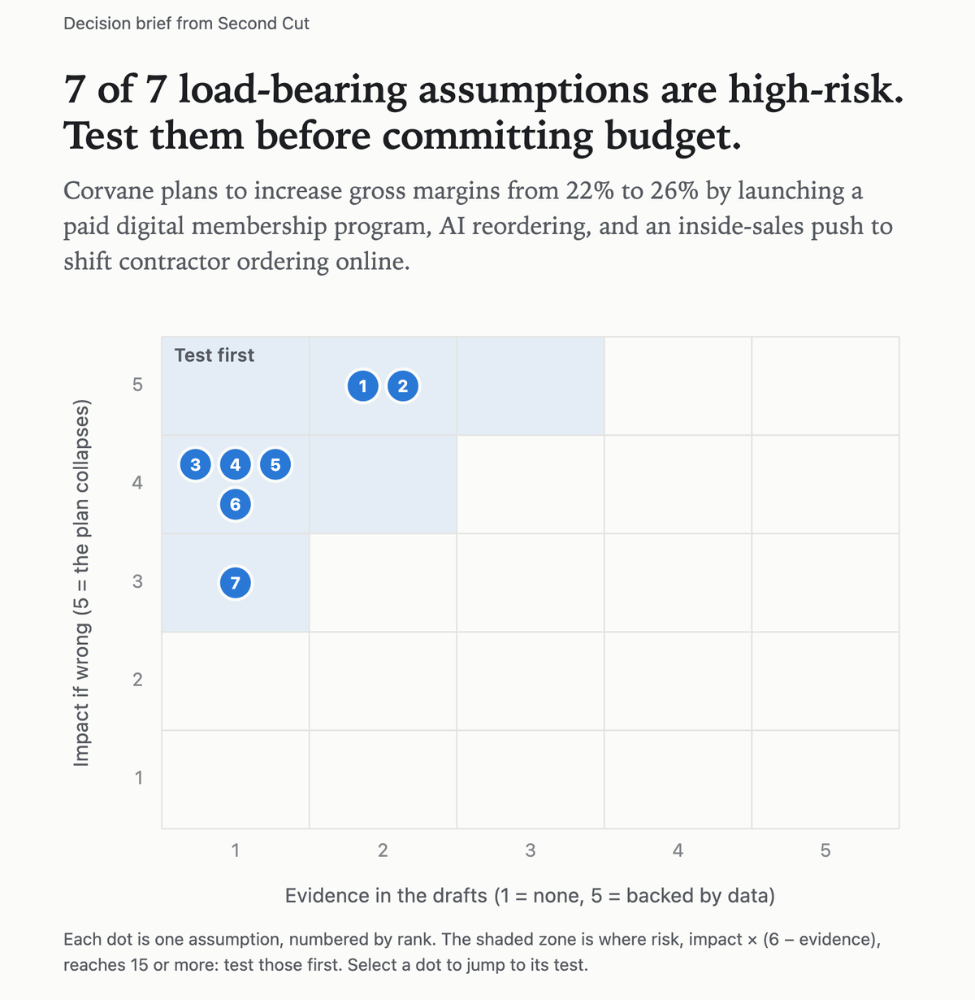
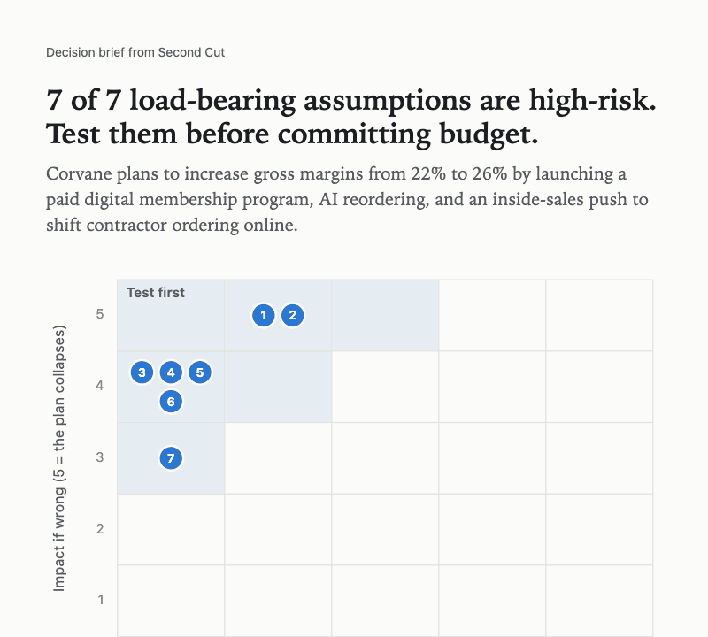
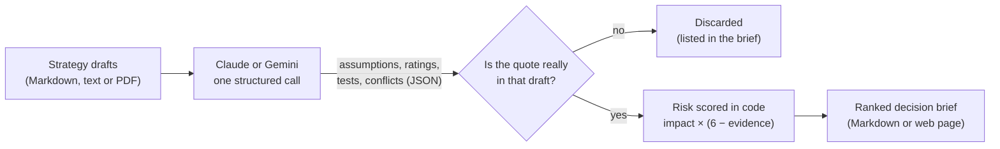

# Second Cut

**An AI agent that stress-tests a strategy before you bet on it.**

[](https://github.com/yengnongxiong/ai-agent-consultant/actions/workflows/tests.yml)


<a href="https://yengnongxiong.github.io/ai-agent-consultant/">
  <picture>
    <source media="(prefers-color-scheme: dark)" srcset="docs/media/hero-dark.png">
    
  </picture>
</a>

**[Open the live example brief](https://yengnongxiong.github.io/ai-agent-consultant/)**: nothing to install, nothing to sign up for.

AI agents can now draft a business strategy in minutes. That draft is a useful first cut, and it
is also a stack of untested bets. Second Cut reads one or more drafts and does three things:

1. **Finds the bets.** It pulls out the beliefs the plan depends on, each backed by an exact quote.
2. **Ranks them by risk.** It shows which belief could sink the plan and how little evidence supports it.
3. **Designs the test.** For each belief it proposes the cheapest experiment that could prove it wrong, with clear "go" and "kill" results.

It also flags places where drafts contradict each other.

> The first draft tells you what to do. The second cut tells you what to prove first.

**Contents:** [See it in action](#see-it-in-action) · [How it works](#how-it-works) ·
[How reliable is it?](#how-reliable-is-it) · [Design choices](#design-choices) ·
[Run it yourself](#run-it-yourself) ·
[Security, privacy and legal](#security-privacy-and-legal) · [Limitations and roadmap](#limitations-and-roadmap) ·
[Project layout](#project-layout) · [Product requirements (PRD)](PRD.md)

---

## See it in action



The [`examples/`](examples/) folder holds two first-cut drafts for **Corvane Industrial Supply**, an
invented regional distributor:

- [`growth-draft.md`](examples/growth-draft.md): an ambitious plan to launch a paid membership, AI reorder suggestions and 20 new sales hires.
- [`workforce-draft.md`](examples/workforce-draft.md): a readiness review of the same company's people, data and constraints.

Each draft sounds reasonable on its own. Read together, they make 10 bets and contradict each other in
5 places. Second Cut turned them into **[this brief](https://yengnongxiong.github.io/ai-agent-consultant/)** (also in [Markdown](examples/brief.md)).
Its top three bets:

| # | Risk | Assumption | Lens | Impact | Evidence |
|---|---|---|---|---|---|
| 1 | **20** | At least 30% of top accounts will pay $49 per month for a membership providing free next-day delivery and bulk pricing. | desirability | 5/5 | 2/5 |
| 2 | **20** | Contractor accounts prefer ordering via digital self-service over calling or visiting physical branch counters. | desirability | 5/5 | 2/5 |
| 3 | **20** | The existing four-person IT team can build an AI demand forecasting reorder model while executing their current commitments. | readiness | 4/5 | 1/5 |

**Test for #1 (14 days):** Have branch managers present a paid pre-order agreement for Corvane Pro to
50 top accounts with first-month billing starting at launch. **Go** if 25% or more sign; **kill** if fewer than 10% do.

**The subtlest contradiction it caught:** the growth draft says *"Reps are the fastest path to adoption
because contractors trust their branch contacts,"* while the workforce draft notes *"Orders that customers
place online earn reps nothing."*

## How reliable is it?

A demo can get lucky, so the example drafts double as a test: they were written around 10 known bets
and 5 known contradictions. [`evals/reliability.py`](evals/reliability.py) runs the analysis repeatedly,
keeps every raw model reply in [`examples/runs/`](examples/runs/), and scores each run against that
answer key. Run 1, not the best run, is the published example.

Five runs with `gemini-3.8-flash`:

| What it measures | Result |
|---|---|
| Contradictions caught | **21 of 25** (84%); the hiring and data-quality conflicts in all 5 runs |
| Bets found | **36 of 50** (72%), below the 80% target in the [PRD](PRD.md#6-success-metrics) |
| Quotes thrown out as untraceable | **0** in every run |
| Most common #1 risk | "Accounts will pay $49 a month," in 3 of 5 runs |

The gap is specific: no run flagged the claim that reorder suggestions lift order frequency by 15%, and
the Q1 hiring bet was usually filed as a contradiction rather than as an assumption. Closing that gap is
the next piece of work, and this harness will measure every prompt change before it ships. Full results:
[`evals/results.md`](evals/results.md).

## How it works



1. **Read.** You give it one or more strategy drafts as Markdown, plain text or PDF. PDFs are converted to text on your machine.
2. **Find the bets.** The model (Claude by default, or Gemini) names the 5 to 12 load-bearing assumptions. It rates each one for **impact** (1 to 5: how badly the plan fails if the belief is wrong) and **evidence** (1 to 5: how much the drafts actually support it), and designs a test for each.
3. **Check the receipts.** Plain code confirms that every assumption's quote appears word for word in the draft it cites. Anything that can't be traced is thrown out and listed, never silently kept.
4. **Rank.** Code computes **risk = impact × (6 − evidence)**, from 1 to 25, and sorts. High impact plus thin evidence floats to the top.
5. **Brief.** The result is a one-page Markdown brief that pastes cleanly into a doc, an email or a ticket.

Every assumption is tagged with one of four lenses, so a reader can see *what kind* of risk dominates:

| Lens | The question it asks |
|---|---|
| **Desirability** | Do customers actually want this? |
| **Viability** | Do the economics work? |
| **Feasibility** | Can we build or deliver it? |
| **Readiness** | Can our people, processes and data absorb the change? |

The first three are the classic product-strategy lens; **readiness** is explained under [Design choices](#design-choices).

## Design choices

Every choice below gave something up. The trade-off column says what.

### Product decisions

| Decision | Why | Trade-off |
|---|---|---|
| **Receipts required.** Every finding quotes its draft word for word, and code checks the quote. | An invented assumption can't reach the brief, and anyone can audit a claim in seconds. | A real assumption the model paraphrases is discarded. The brief lists every discard, so nothing disappears silently. |
| **Tests must be able to fail.** Every test states a go result *and* a kill result. | A test that can't fail can't change a decision. | Thresholds are model-suggested starting points; teams should set their own before running a test. |
| **A fourth lens: readiness.** Desirability, viability and feasibility, plus "can the organization absorb this?" | Many strategies that pass the first three still fail on execution. | Four buckets simplify a messy reality. |
| **Judge only what's written.** No web search; evidence is rated from the drafts alone. | It shows how well a draft supports itself, and keeps runs fast, cheap and repeatable. | It can't say whether outside evidence exists, only that the draft didn't show it. |
| **Explicit provider choice.** `--provider claude` or `--provider gemini`, never guessed from which key is set. | Companies often approve one AI vendor, and you should always know who receives your drafts. | Two integrations to maintain, and results vary by model. |
| **Measure before tuning.** A scored answer key, with the first run published rather than the best. | Prompt changes get judged by numbers, not by one good-looking demo. | One invented company is a small test set. |

### Engineering decisions

| Decision | Why | Trade-off |
|---|---|---|
| **The model judges; code computes.** The model rates impact and evidence; Python scores, ranks and verifies. | The same ratings always give the same ranking, and the scoring rule is one line anyone can read. | Ratings of 1 to 5 are coarse and shift between runs. |
| **One structured call, not a chain of agents.** | One cost, one point of failure, one place to audit. | No separate critic pass; add one only if the harness shows it pays off. |
| **Schema-validated output.** Pydantic models define the reply, enforced by each provider's structured-output mode and validated again locally. | No fragile text parsing, and an instruction hidden in a draft can only produce data in the expected shape. | Changing the output means changing the schema in code. |
| **Quote matching ignores layout, not content.** Case, spacing, line breaks, hyphens, curly quotes and ligatures are normalized before comparing. | Honest quotes survive PDF line wraps and bold text, while an altered number still fails. | A paraphrase never matches, by design. |
| **PDFs parsed locally.** Text is extracted with `pypdf` before anything is sent. | The quote check sees exactly what the model saw, and images and file metadata never leave your machine. | Scanned pages and charts are invisible. |
| **A web brief with zero JavaScript.** The SVG chart is generated in Python, and a Content-Security-Policy forbids scripts and remote files. | It opens anywhere, from a link or an email attachment, with nothing to exploit or track. | No sorting or filtering, only a basic hover tooltip. |
| **No server, no database.** A command-line tool writes a file. | Nothing to host, maintain or breach. | Someone has to run one command. |
| **A small, pinned supply chain.** Two runtime dependencies, hash-locked versions, SHA-pinned CI actions with a read-only token. | Fewer ways for a compromised package or workflow to get in. | Upgrades are deliberate, manual steps. |

### Tech stack at a glance

| Layer | Choice |
|---|---|
| Language | Python 3.11+, the whole agent in [one module](secondcut.py) |
| AI models | Claude Opus 5.5 by default (adaptive thinking, high effort, streaming, server-side refusal fallback), or Gemini 3.8 Flash |
| Output contract | Pydantic models used as the JSON schema |
| Inputs | Markdown, plain text and PDF (`pypdf`, parsed locally) |
| Outputs | Markdown brief, or a self-contained HTML page with an inline SVG risk map |
| Quality | Offline `pytest` suite with fake AI clients (runs in about a second), plus the [reliability harness](evals/reliability.py) |
| Packaging | `uv` with a hash-locked `uv.lock`; Google's SDK is an optional extra |
| CI and hosting | GitHub Actions on every push; GitHub Pages serves the [live example](https://yengnongxiong.github.io/ai-agent-consultant/) |

## Run it yourself

You need [Python 3.11+](https://www.python.org/downloads/), [uv](https://docs.astral.sh/uv/getting-started/installation/)
and an [Anthropic API key](https://console.anthropic.com/), or a Gemini key (see below).

```bash
git clone https://github.com/yengnongxiong/ai-agent-consultant.git
cd ai-agent-consultant

# Paste your key at the prompt. It is read without echoing and stays out of your shell history.
read -rs ANTHROPIC_API_KEY && export ANTHROPIC_API_KEY

uv run secondcut.py examples/growth-draft.md examples/workforce-draft.md > brief.md
```

**Using Gemini instead?** Get a key from [Google AI Studio](https://aistudio.google.com/apikey), then:

```bash
read -rs GEMINI_API_KEY && export GEMINI_API_KEY
uv run --extra gemini secondcut.py --provider gemini examples/growth-draft.md examples/workforce-draft.md > brief.md
```

`uv` installs the exact dependency versions from `uv.lock` on first run. Progress and token usage
print to the terminal, and the brief goes to `brief.md`. Use your own drafts by passing their file paths instead; Markdown, text and PDF files all work.

Add `--html` to get the visual brief as a single web page instead of Markdown:

```bash
uv run secondcut.py --html examples/growth-draft.md examples/workforce-draft.md > brief.html
```

To reproduce the reliability numbers (five runs on your Gemini key):

```bash
uv run --extra gemini python -m evals.reliability --provider gemini --runs 5
```

To run the test suite (no API key, no network, under a second):

```bash
uv run pytest
```

## Security, privacy and legal

- **Your drafts go to exactly one place:** the AI provider you choose (Anthropic by default, or Google), over HTTPS. Second Cut has no server, database, logging, telemetry or analytics, and it saves nothing except the brief you redirect to a file. Each provider's terms govern how it handles inputs: see Anthropic's [commercial terms](https://www.anthropic.com/legal/commercial-terms) and Google's [Gemini API pricing page](https://ai.google.dev/gemini-api/docs/pricing). **Google's free tier may use inputs to improve its products, so never send confidential drafts on a free key.** Check your organization's policy first.
- **Your API key** is read from the environment by the provider's official SDK. It is never written to disk, logged or printed.
- **Drafts are treated as untrusted input.** They are clearly labeled as data, and the model is told never to follow instructions inside them. The model has no tools: it cannot browse, run code or touch files. Its only output is JSON checked against a schema, and its text is escaped before going into the brief, so a malicious draft can't plant links or HTML (even bare web addresses are defused so GitHub won't turn them into links). The web brief carries a Content-Security-Policy that blocks all scripts and remote files. Inspected in a headless browser, it loads zero scripts and makes zero network requests. PDFs are parsed locally by `pypdf`, a pure-Python library with no native code. Files over 20 MB are refused, and so are password-protected ones.
- **Cost is bounded.** Input is capped at 200,000 characters per run, and every run prints its token usage.
- **Small supply chain.** By default there are two runtime dependencies: the official `anthropic` SDK and `pypdf`, which has no dependencies of its own. Google's official SDK installs only if you opt into Gemini. Every version is locked by hash in `uv.lock`. CI runs with read-only permissions, uses actions pinned to exact commits, and fails if the lockfile drifts.
- **Legal.** MIT licensed. This is an independent project, not affiliated with or endorsed by any company. The example company and its figures are fictional. Output is AI-generated analysis, not professional, financial or legal advice.

## Limitations and roadmap

**Known limitations**

- It knows only what is in the drafts: no market data and no outside research (see *Judge only what's written* under [Design choices](#design-choices)).
- The ranking rule is fixed, but the ratings that feed it come from a model and shift between runs: across five runs the same #1 risk came up 3 times.
- Quote matching compares characters only, ignoring case, spacing, line breaks, hyphens, curly quotes and bold text. A paraphrased quote is discarded, even when the idea behind it is real.
- Scanned PDFs (pictures of text) and slide decks aren't supported, and charts or images inside PDFs are ignored.

**Next, in priority order (not built yet)**

1. **Close the recall gap:** raise bets found from 72% to 80% or more by iterating the prompt against the reliability harness, then compare Claude Opus 5.5 with Gemini Flash on the same answer key.
2. **Agent-to-agent use:** expose Second Cut as an [MCP](https://modelcontextprotocol.io/) tool so other AI agents can call it right after drafting a strategy.
3. **Assumption tracking:** save results as data, so a team can record test outcomes and re-rank as evidence arrives.

## Project layout

```text
secondcut.py   The agent: prompt, output schema, quote checks, scoring, Markdown and HTML briefs
template.html  Layout and styles for the web brief
tests/         Offline tests with fake clients: no API key, no network, no cost
evals/         Reliability harness scored against the example drafts' answer key, plus results
examples/      Fictional input drafts, the published brief, and every raw model reply
docs/          The live example brief served by GitHub Pages, plus README images
PRD.md         Product requirements: problem, users, goals, success metrics, risks
```

The agent's instructions to the model are plain English: see `SYSTEM` near the top of
[`secondcut.py`](secondcut.py). Changing how the agent thinks means editing a paragraph, not code.

## About

Built by [Yengnong Xiong](https://github.com/yengnongxiong) as a product management portfolio project.
The [PRD](PRD.md), the trade-offs and the measured results are as much the point as the code.
Questions and feedback are welcome through [GitHub issues](https://github.com/yengnongxiong/ai-agent-consultant/issues).

## License

[MIT](LICENSE) © 2026 Yengnong Xiong
